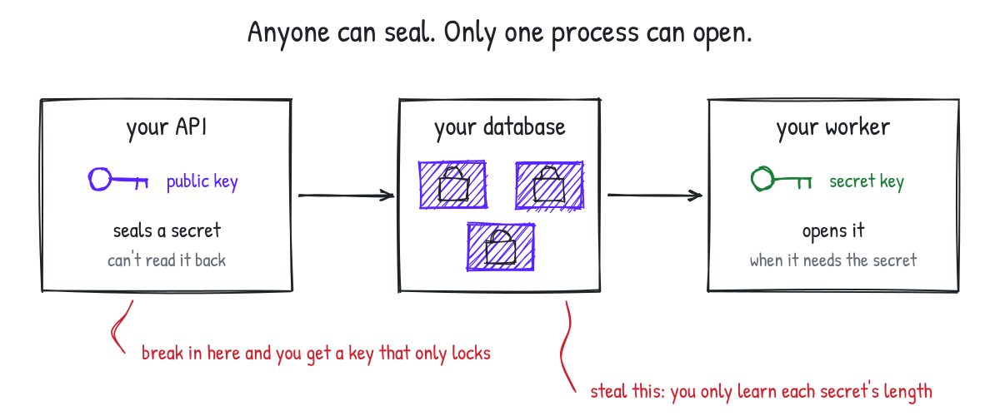
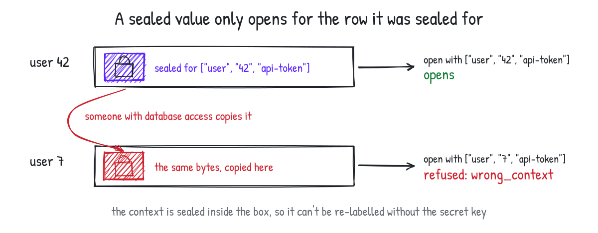
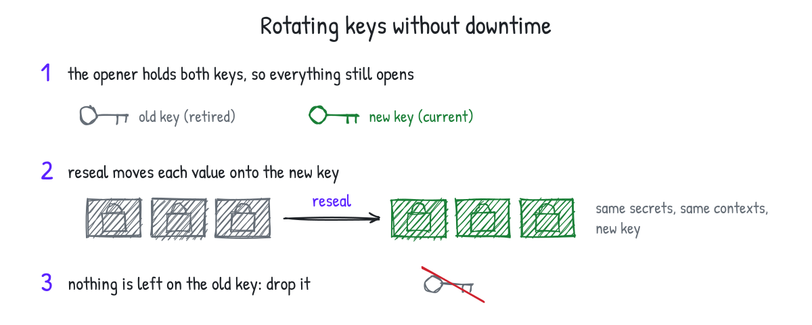
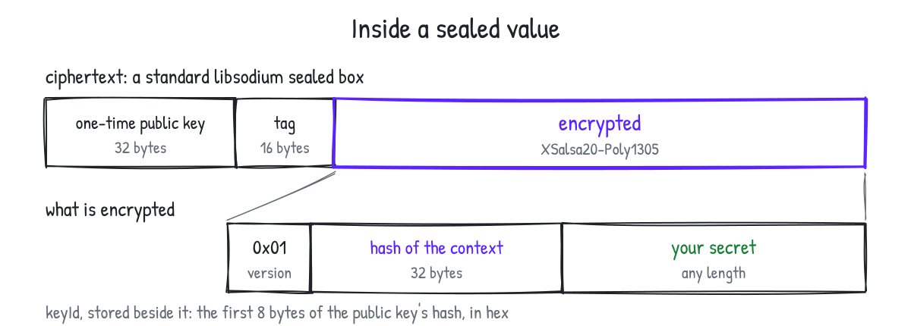

<p align="center">
  
</p>

# sealbound

Store secrets in your own database: sealed with a public key, bound to what they belong to, with key rotation.

[](https://www.npmjs.com/package/sealbound) [](https://www.npmjs.com/package/sealbound) [](https://github.com/bayasdev/sealbound/actions/workflows/ci.yml) [](https://github.com/bayasdev/sealbound/blob/main/LICENSE)

```typescript
import { createOpener, createSealer } from "sealbound";

// The web app holds only the public key: it can store a secret, never read one.
const sealer = createSealer(process.env.SEAL_PUBLIC_KEY);
const sealed = sealer.seal(new TextEncoder().encode(apiToken), [
  "user",
  String(user.id),
  "api-token",
]);
await db.insert(tokens).values({ userId: user.id, ...sealed });

// The worker that needs the secret holds the secret key.
const opener = createOpener({ secretKey: process.env.SEAL_SECRET_KEY });
const token = opener.open(row, ["user", String(row.userId), "api-token"]);
```

<picture>
  <source media="(prefers-color-scheme: dark)" srcset="https://raw.githubusercontent.com/bayasdev/sealbound/main/.github/diagrams/who-holds-what-dark.svg">
  
</picture>

- **Write-only where it should be.** Sealing needs the public key alone. A process that only stores secrets, such as an API that takes uploads, can't read back anything it stored, and neither can whoever breaks into it.
- **Bound to its owner.** Every value is sealed together with a context that names what it belongs to. Copy a sealed value onto another user's row and it fails to open, instead of opening as that user's.
- **Key rotation built in.** Each value records the key that sealed it. The opener holds the current key and the retired ones, and `reseal` moves a value onto the current key.
- **A standard box.** A sealed value is a libsodium sealed box (`crypto_box_seal`: X25519 and XSalsa20-Poly1305), so libsodium in any language can open it. The tests check that both ways.
- **Runs everywhere.** Node.js, Bun, Deno, browsers and Cloudflare Workers, with no native module and no WebAssembly. The cryptographic primitives are the [noble](https://paulmillr.com/noble/) libraries'.

## Install

```bash
pnpm add sealbound
```

Or `npm install sealbound`, `yarn add sealbound`, `bun add sealbound`.

It is an ES module, and `require("sealbound")` loads it on Node.js 22.12 or later.

## Use

### Make a key pair

```typescript
import { generateKeys } from "sealbound";

const { publicKey, secretKey } = generateKeys();
```

Both are base64 strings, ready for environment variables. Give the public key to the servers that store secrets and the secret key only to what must read them. Don't ship the public key to browsers or apps: see [what it protects](#what-it-protects-and-what-it-doesnt).

### Seal

#### `createSealer(publicKey: string): Sealer`

```typescript
const sealer = createSealer(publicKey);
const sealed = sealer.seal(bytes, ["user", "42", "api-token"]);
// { ciphertext: Uint8Array, keyId: "9f2c41d07a3be865" }
```

A public key and a secret key look alike, 32 bytes of base64 each, so the library can't tell when one is passed for the other: a sealer made from a secret key seals values nothing opens. Name your variables so that can't happen.

Store both fields. `seal` takes a `Uint8Array`; use `new TextEncoder().encode(text)` for a string.

The second argument is the **context**: what the value belongs to. It isn't stored and it isn't secret. You give the same one again to open.

- Give it as a list of parts: the kind of owner, the owner's id and, when one row holds several secrets, which one it is. Parts are kept apart, so `["org", "a:b", "c"]` and `["org", "a", "b:c"]` are two contexts. A single string works too, and is the same as a list of one part.
- When an owner can have several values of one kind, such as two API tokens, add a part that tells them apart, like the token's own id: `["user", "42", "api-token", tokenId]`. Two values sealed for the same context can be swapped for each other.
- Every part is a non-empty string: convert ids with `String(id)`. A missing id is refused instead of quietly becoming the text `"undefined"`.
- Contexts are compared byte for byte. `"é"` written as one character and as `e` plus an accent are two contexts, so build them from ids, not from text people type.

<picture>
  <source media="(prefers-color-scheme: dark)" srcset="https://raw.githubusercontent.com/bayasdev/sealbound/main/.github/diagrams/bound-to-its-owner-dark.svg">
  
</picture>

### Open

#### `createOpener({ secretKey, retiredSecretKeys? }): Opener`

```typescript
const opener = createOpener({ secretKey });
const bytes = opener.open(sealed, ["user", "42", "api-token"]);
```

`opener.publicKey` is the public key that goes with the secret key, for the sealers.

`open` throws a `SealboundError` when the value can't be opened, with the reason in `reason`.

| `reason` | What happened |
| --- | --- |
| `"wrong_context"` | The value was sealed for another context: it belongs to something else. |
| `"corrupt"` | The ciphertext was altered or damaged. |
| `"unknown_key"` | It was sealed with a key this opener doesn't hold. |
| `"unsupported_version"` | It has a layout this version of the library doesn't read. |
| `"malformed"` | What was passed isn't a sealed value: for example, the ciphertext came back from the database as a string, it is shorter than anything this library seals, or the text wasn't written by `encode`. |

Every function checks what it is given and throws one too.

| `reason` | What happened |
| --- | --- |
| `"invalid_value"` | The value to seal isn't a `Uint8Array`. |
| `"invalid_context"` | The context is empty, has an empty part, isn't made of strings, or has a broken character (a lone surrogate). |
| `"invalid_key"` | A key isn't 32 bytes of standard base64, or is a public key nothing can be sealed to. |
| `"key_mismatch"` | `reseal` was given a sealer that doesn't seal with the opener's current key. |

### Store it as text

#### `encode(sealed): string` and `decode(text): Sealed`

For a text column, `encode` writes a sealed value as one string and `decode` reads it back.

```typescript
encode(sealed); // "sb1.9f2c41d07a3be865.kX0rV2c8…"
```

### Rotate keys

#### `reseal({ opener, sealer }, sealed, context): Sealed | null`

<picture>
  <source media="(prefers-color-scheme: dark)" srcset="https://raw.githubusercontent.com/bayasdev/sealbound/main/.github/diagrams/key-rotation-dark.svg">
  
</picture>

1. Make a new key pair. Give the openers the new secret key, with the old one as retired: `createOpener({ secretKey: newSecret, retiredSecretKeys: [oldSecret] })`. Old and new values both open.
2. Give the sealers the new public key.
3. Run `reseal` over every stored value and save what it returns. It returns `null` for a value already on the current key, and it opens each value it moved with the current key before returning it, so a rotation can't look finished while values stay behind: a sealer that isn't on the opener's current key is refused.
4. When no stored value has the old `keyId`, drop the old key from the retired list.

Use a sealer from `createSealer`. `reseal` hands the sealer each opened value, so a sealer of your own sees every secret; `reseal` checks what it returns, not what it does with what it was given.

```typescript
const sealer = createSealer(opener.publicKey);
for (const row of await db.select().from(tokens)) {
  const moved = reseal({ opener, sealer }, row, [
    "user",
    String(row.userId),
    "api-token",
  ]);
  if (moved) {
    await db.update(tokens).set(moved).where(eq(tokens.id, row.id));
  }
}
```

## The format

<picture>
  <source media="(prefers-color-scheme: dark)" srcset="https://raw.githubusercontent.com/bayasdev/sealbound/main/.github/diagrams/inside-a-sealed-value-dark.svg">
  
</picture>

A sealed value's `ciphertext` is a libsodium sealed box (`crypto_box_seal`) of:

| Bytes    | Content                            |
| -------- | ---------------------------------- |
| 1        | `0x01`, the version of this layout |
| 32       | the context's digest               |
| the rest | the value                          |

The context's digest is BLAKE2b-256 of the ASCII bytes `sealbound/v1` followed, for each part, by the length of the part's UTF-8 bytes as a 32-bit big-endian integer and those bytes. A context has at least one part, and every part is a non-empty string of valid Unicode. One string is a context of that one part.

`keyId` is BLAKE2b of the public key with an 8-byte digest, in lowercase hex: libsodium's `crypto_generichash(8, publicKey)`. It is not the first 8 bytes of a longer BLAKE2b digest, because the digest's length is part of what BLAKE2b hashes.

As text, a sealed value is `sb1.<keyId>.<ciphertext in base64url without padding>`. Only that exact text is read back: padding, capitals in the key id, or spare bits set in the last character are refused.

To open one with libsodium in another language:

1. `crypto_box_seal_open(ciphertext, publicKey, secretKey)`. A ciphertext is at least 81 bytes.
2. Refuse what it returns if it is shorter than 33 bytes, or if its first byte isn't `0x01`.
3. Compute the digest of the context you expect and compare it with bytes 1 to 32, in constant time. Refuse it if they differ.
4. The rest is the value.

Values sealed by any 1.x version keep opening in every later version, with one exception: 1.0.0 derived the box key wrongly on big-endian machines, so a value 1.0.0 sealed on one opens only with 1.0.0. Open such values with 1.0.0 and seal them again with a later version. A test opens a value that libsodium sealed, so the format can't drift without notice. A sealed value stored as its two fields carries no version outside the box; if the box itself ever changes, the key id's form will tell the two apart, and the text form will get a new prefix.

## What it protects, and what it doesn't

- **Reading the database isn't enough.** Someone who reads your database, or takes over a process that holds only the public key, learns nothing about the values but their length.
- **A value can't be moved to another context.** Someone who can write to the database can't make one owner's value open as another's. Two values sealed for the same context can be swapped, so give each its own.
- **An old value can be put back.** Someone who can write to the database can restore an earlier sealed value for the same context, such as a token you replaced, and it opens. If that matters, put a version or a date in the context.
- **The public key lets anyone seal.** Whoever has the public key can seal a value of their own for any context, and with write access to the database can replace a stored secret with one they know. Keep the public key on your servers. The context stops a value from being moved; it doesn't prove who stored it.
- **The secret key opens everything.** Sealed boxes have no forward secrecy: after a leak, rotate, reseal, and treat what was sealed before as exposed.
- **The context and the key id aren't hidden.** Don't put a secret in a context.
- **Secrets stay in memory until the engine frees it.** JavaScript has no way to wipe a key or an opened value.
- **JavaScript isn't constant-time.** The noble libraries aim for constant-time algorithms, but no JavaScript engine guarantees it. An attacker who can make your opener process many values of their choosing and time it precisely is outside what this protects against.

The primitives (X25519, XSalsa20-Poly1305 and BLAKE2b) come from [noble-curves](https://github.com/paulmillr/noble-curves#security), [noble-ciphers](https://github.com/paulmillr/noble-ciphers#security) and [noble-hashes](https://github.com/paulmillr/noble-hashes#security), which have been audited by independent firms; each link lists its audits and what changed since. This library's own code has not been audited: that is how it puts those primitives together into a sealed box, the layout above and the key handling. The sealed box is checked against libsodium in the tests, in both directions.

## Contributing

```bash
pnpm install
pnpm check        # format, lint and unused code
pnpm check-types  # types
pnpm test         # tests
pnpm build        # builds dist/
```

Every change reaches `main` through a pull request. The repository's rules are in [AGENTS.md](https://github.com/bayasdev/sealbound/blob/main/AGENTS.md), and [SECURITY.md](https://github.com/bayasdev/sealbound/blob/main/SECURITY.md) says how to report a vulnerability.

## License

[Apache 2.0](https://github.com/bayasdev/sealbound/blob/main/LICENSE).
